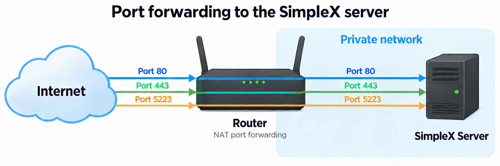

# Installing your personal SimpleX server

This document shows how to install a SimpleX server on Ubuntu 24.04.

In the following document:
- the variable `DOMAIN` represents the domain name you want to assign to your SimpleX server.
- the _server host_ is the host you want to install SimpleX to.

## Prerequisites

### Operating system

We use `Ubuntu 24.04.5 LTS`. 

```bash
dev@turbo:~$ cat /etc/os-release | grep "PRETTY_NAME"
PRETTY_NAME="Ubuntu 24.04.5 LTS"
```

> We've chosen the minimal flavor. But you can use another flavor.

### Domain name

You have a domain name. In the following document, the variable BASH `DOMAIN` represents the domain name associated with the SIMPLX server. Please note that you can use [DuckDns](https://www.duckdns.org) to have a free domain name.

### Router configuration (NAT configuration)

If you install the server on a VPS, then skip this section.



| **Public port** | **Internal Port** |
|-----------------|-------------------|
| TCP:80          | 80                |
| TCP:443         | 443               |
| TCP:5223        | 5223              |

Check your NAT configuration: [Checking NAT configuration](check-nat.md)

### Docker

See [https://docs.docker.com/engine/install/ubuntu/#install-using-the-apt-repository](https://docs.docker.com/engine/install/ubuntu/#install-using-the-apt-repository)

```bash
sudo apt remove $(dpkg --get-selections docker.io docker-compose docker-compose-v2 docker-doc docker-buildx podman-docker containerd runc | cut -f1)
sudo apt update
apt list --upgradable
sudo install -m 0755 -d /etc/apt/keyrings
sudo curl -fsSL https://download.docker.com/linux/ubuntu/gpg -o /etc/apt/keyrings/docker.asc
sudo chmod a+r /etc/apt/keyrings/docker.asc
sudo tee /etc/apt/sources.list.d/docker.sources <<EOF
Types: deb
URIs: https://download.docker.com/linux/ubuntu
Suites: $(. /etc/os-release && echo "${UBUNTU_CODENAME:-$VERSION_CODENAME}")
Components: stable
Architectures: $(dpkg --print-architecture)
Signed-By: /etc/apt/keyrings/docker.asc
EOF
sudo apt update
sudo apt install docker-ce docker-ce-cli containerd.io docker-buildx-plugin docker-compose-plugin
```

Reboot:

```bash
sudo reeboot
```
Then test the installation:

```bash
sudo systemctl status docker
sudo docker run hello-world
``` 
## Check the OS

```bash
dev@turbo:~$ cat /etc/os-release | grep "PRETTY_NAME"
PRETTY_NAME="Ubuntu 24.04.5 LTS"
```

## Create a user `simplex`

```bash
sudo adduser --disabled-password --gecos "" --shell /bin/bash simplex
echo "DenyUsers simplex" | sudo tee -a /etc/ssh/sshd_config
sudo usermod -aG sudo simplex
sudo passwd simplex
sudo sshd -t && sudo systemctl reload ssh
```

Note:
- see [https://github.com/simplex-chat/simplexmq/tree/stable/scripts/docker](https://github.com/simplex-chat/simplexmq/tree/stable/scripts/docker)
- see [https://simplex.chat/docs/server.html#docker-automatic-setup](https://simplex.chat/docs/server.html#docker-automatic-setup) 

```bash
sudo -iu simplex
mkdir smp-server && cd smp-server
wget https://raw.githubusercontent.com/simplex-chat/simplexmq/refs/heads/stable/scripts/docker/docker-compose-smp-complete.yml
mv docker-compose-smp-complete.yml docker-compose.yml
wget https://raw.githubusercontent.com/simplex-chat/simplexmq/refs/heads/stable/scripts/docker/docker-compose-smp.env
mv docker-compose-smp.env .env
```

## Configure the Docker build

```bash
# WARNING: if you have spacial characters in your password, then do not use `send`.
#          Edit the file `docker-compose-smp.env` manually instead.
cat .env | sed -E "s/^ADDR=.*/ADDR=${DOMAIN}/g ; s/^#?PASS=.*/PASS=${PASSWORD}/g" # Check the output!
sed -Ei "s/^ADDR=.*/ADDR=${DOMAIN}/g ; s/^#?PASS=.*/PASS=${PASSWORD}/g" .env && cat .env 
```

## Start the containers

First, make sure that no process use port 80, 443 or 5223.

```bash
sudo ss -lntp 'sport = :80'
sudo ss -lntp 'sport = :443'
sudo ss -lntp 'sport = :5223'
```

Then, start the containers:

```bash
sudo docker compose up
```

Make sure to copy the address of four server:

```
smp-server-1  | SMP server v7.0.1.0 /
smp-server-1  | Fingerprint: xxx
smp-server-1  | Server address: smp://xxx@xxx:5223,443
```

The server's address is: `smp://xxx@xxx` (please note that we've removed the suffix "`:5223,443`")

> - You can use this QR code generator to generate a QR code for your server's address: [https://click-and-shield.github.io/privacy-tools/web/qrcode.html](https://click-and-shield.github.io/privacy-tools/web/qrcode.html)
> - You can consult the LOG to retrieve the server's address:
>  
>   ```bash
>   sudo docker compose logs --no-color --no-log-prefix smp-server 2>&1 | grep -F "Server address"
>   ``` 

Check that the server is running:

```bash
sudo docker container ls --all --format   "{{.ID}} {{.Names}} {{.Status}}" --filter="status=running"
```

Result:

```bash
simplex@turbo:~/smp-server$ sudo docker container ls --all --format "{{.ID}} {{.Names}} {{.Status}}" --filter="status=running"
3db6cc1096e6 simplexchat-smp-server-smp-server-1 Up 43 minutes
cdb9f5ad6720 simplexchat-smp-server-caddy-1      Up 43 minutes (healthy)
```

Check that the server WEB interface is accessible: open the URL `https://${DOMAIN}` in a WEB browser.

> Please keep in mind that `${DOMAIN}` is the domain associated with the SimpleX server (for example: `example.com`, or `mysimplex.duckdns.org`).

# Directory tree

If you've followed this procedure above, then you should have the following directory tree under `/home/simplex/smp-server`:

```
simplex@turbo:~/smp-server$ tree
.
├── caddy_conf
│   └── Caddyfile
├── docker-compose.yml
├── smp_configs
│   ├── ca.crt
│   ├── ca.key
│   ├── ca.srl
│   ├── fingerprint
│   ├── openssl_ca.conf
│   ├── openssl_server.conf
│   ├── server.crt
│   ├── server.csr
│   ├── server.key
│   └── smp-server.ini
└── smp_state
    ├── backups
    │   ├── messages
    │   ├── queues
    │   └── stats
    ├── smp-server-stats.daily.log
    ├── smp-server-store.log
    └── www
        ├── a
        │   └── index.html
        ├── c
        │   └── index.html
        ├── contact
        │   └── index.html
        ├── g
        │   └── index.html
        ├── i
        │   └── index.html
        ├── index.html
        ├── invitation
        │   └── index.html
        ├── media
        │   ├── apk_icon.png
        │   ├── apple_store.svg
        │   ├── contact.js
        │   ├── contact_page_mobile.png
        │   ├── favicon.ico
        │   ├── f_droid.svg
        │   ├── GilroyBold.woff2
        │   ├── GilroyLight.woff2
        │   ├── GilroyMedium.woff2
        │   ├── GilroyRegularItalic.woff2
        │   ├── GilroyRegular.woff2
        │   ├── google_play.svg
        │   ├── logo-dark.png
        │   ├── logo-light.png
        │   ├── logo-symbol-dark.svg
        │   ├── logo-symbol-light.svg
        │   ├── moon.svg
        │   ├── qrcode.js
        │   ├── script.js
        │   ├── style.css
        │   ├── sun.svg
        │   ├── swiper-bundle.min.css
        │   ├── swiper-bundle.min.js
        │   ├── tailwind.css
        │   └── testflight.png
        ├── r
        │   └── index.html
        └── well-known
            ├── apple-app-site-association
            └── assetlinks.json
```

The description for these directory is given [hare](tree.md).

## Notes

If you need to stop a container:

```bash
sudo docker stop <container ID> 
```

If you need to delete a container:

```bash
sudo docker rm <container ID> 
```

If you need to start a container:

```bash
sudo docker start <container id>
```
 
Check that the containers are ruuning:

```bash 
sudo docker ps --filter="name=${NAME}" --filter="status=running" --format="{{.ID}} {{.Names}} {{.Status}}"
  ```

Consult the LOGs for a container:

```bash
sudo docker logs --tail 200 <container id>
```
